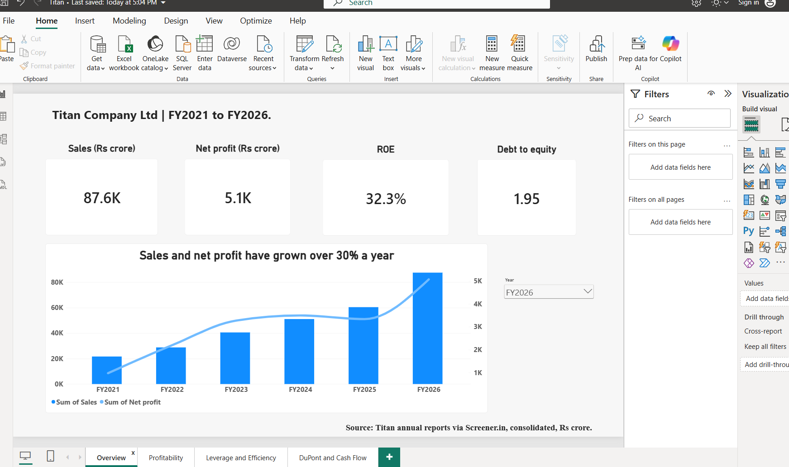
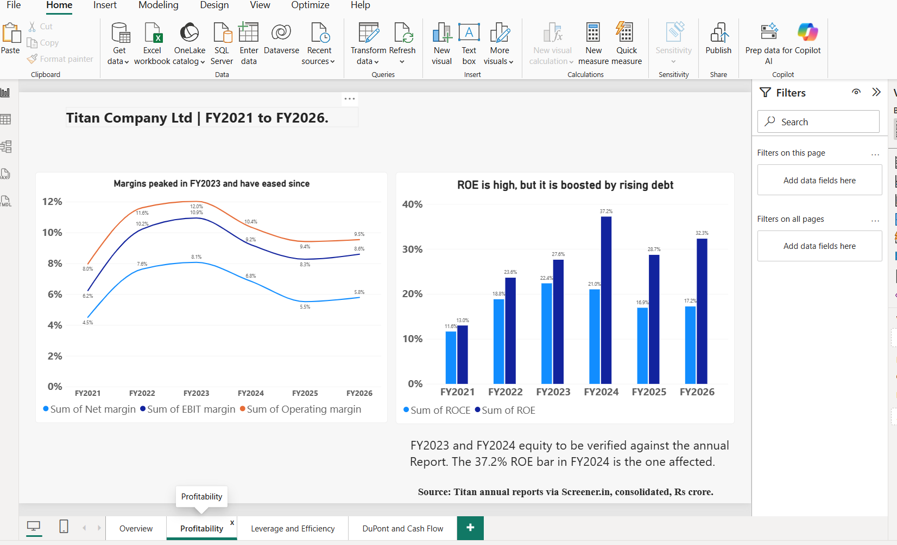
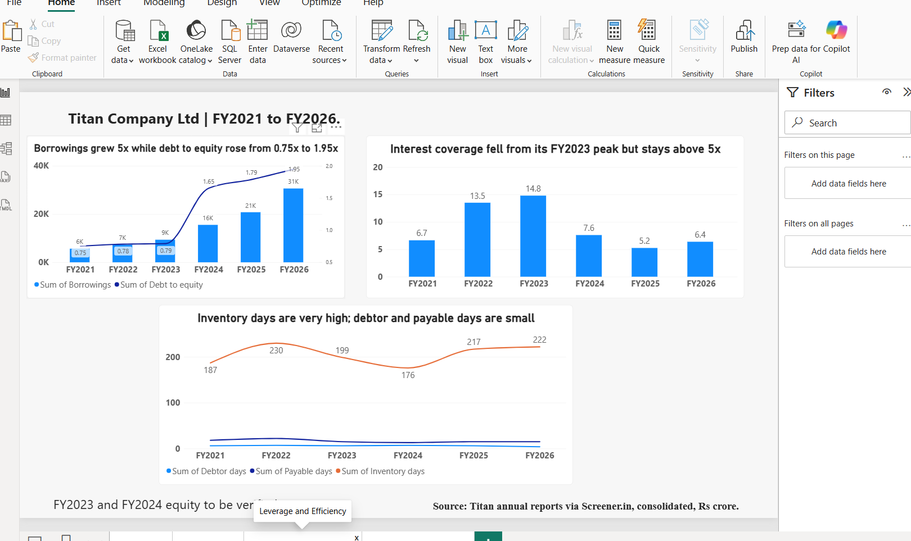
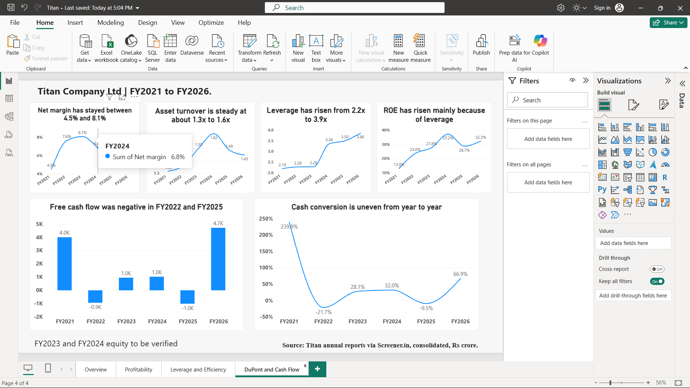

# Titan Company Ltd: Financial Statement and Ratio Analysis (FY2021 to FY2026)

A six-year analysis of Titan Company Ltd's consolidated financials, built in Excel and presented as a four-page Power BI dashboard. The project covers growth, profitability, leverage, working capital and cash flow, with a DuPont breakdown of return on equity (ROE).

**Tools:** Microsoft Excel (formulas, rebuilt statements, ratio analysis), Power BI Desktop (dashboard)
**Author:** Saran M | [LinkedIn](https://linkedin.com/in/saran-m-914754259)

---

## Dashboard preview

| Overview | Profitability |
|---|---|
|  |  |

| Leverage and Efficiency | DuPont and Cash Flow |
|---|---|
|  |  |

The full dashboard is in [`Titan_Dashboard.pdf`](Titan.pdf). The interactive version is [`Titan_Dashboard.pbix`](Titan.pbix) (open it with Power BI Desktop).

---

## Key findings

All figures are in Rs crore, consolidated.

**Growth**
- Sales grew from 21,644 (FY2021) to 87,584 (FY2026), a CAGR of about 32%.
- Net profit grew from 974 to 5,073, a CAGR of about 39%.

**Profitability**
- Operating margin rose from 8.0% in FY2021 to a peak of 12.0% in FY2023, then eased to 9.5% in FY2026.
- Net margin moved from 4.5% to 5.8% over the period (peak 8.1% in FY2023).

**Return on equity (DuPont)**
- ROE rose from 13.0% to 32.3% (year-end equity basis).
- The drivers: net margin 4.5% to 5.8%, asset turnover 1.32x to 1.45x, equity multiplier 2.19x to 3.86x. Most of the ROE improvement comes from leverage, not from margin.

**Leverage**
- Borrowings rose from 5,638 to 30,621, and debt to equity from 0.75x to 1.95x.
- Interest coverage was 6.7x in FY2021, peaked at 14.8x in FY2023 and was 6.4x in FY2026 (low of 5.2x in FY2025).

**Working capital**
- Inventory days are high (187 in FY2021, 222 in FY2026), while debtor days (4 to 7) and payable days (13 to 22) are small.

**Cash flow**
- Operating cash flow was negative in FY2022 (-724) and FY2025 (-541) despite positive profits.
- FY2021 operating cash flow was 4,139, or 239.9% of operating profit. The audited cash flow statement shows this includes a 2,625 increase in gold on loan, which Titan classifies in operating activities. Excluding it, the ratio is about 88% (my calculation).

---

## What is in this repository

| File | Contents |
|---|---|
| `Titan_Dashboard.pbix` | Power BI dashboard, four pages |
| `Titan_Dashboard.pdf` | PDF export of the dashboard |
| `Titan_Financial_Analysis.xlsx` | Inputs, rebuilt statements, 20+ ratios, written analysis, and the Power BI data table |
| `screenshots/` | One image per dashboard page |

**Excel workbook sheets:** Guide, Inputs, Statements (with balance, PBT and liabilities checks), Ratios, Analysis, PowerBI_Data.

**Ratios covered:** sales, operating profit and net profit growth; operating, EBIT and net margins; ROA, ROE and ROCE; debt to equity, debt to EBITDA, interest coverage; asset turnover, fixed asset turnover; debtor, inventory and payable days; cash conversion cycle; CFO to EBITDA; DuPont components.

---

## Data source and method

- Consolidated figures from Screener.in (retrieved November 2026), which standardises the audited statements in Titan's annual reports.
- FY2021 was checked against Titan's Annual Report 2020-21 (consolidated statements). Sales, net profit, profit before tax, depreciation, interest, reserves and operating cash flow match. Two small differences remain: other income (186 in the report vs 180 in Screener) and total assets (16,452 vs 16,444).
- Operating cash flow for FY2022 to FY2026 matches a second source (StockAnalysis).
- All return ratios use year-end balances, not averages, so they can differ from published figures.
- EBIT = operating profit minus depreciation. ROCE = (profit before tax + interest) / (total assets minus other liabilities), which is a proxy.

---

## Limitations

1. **Equity in FY2023 and FY2024 is unverified.** Reserves in the source data fall from 11,762 to 9,304 despite profits. ROE and debt to equity for these two years should be treated with caution.
2. **"Borrowings" includes more than bank debt.** In FY2021 the figure appears to include gold on loan (4,210) and lease liabilities. This was checked for FY2021 only. Debt ratios therefore include gold loans, which are linked to gold inventory.
3. **No current ratio or quick ratio.** The condensed balance sheet has no current-asset or current-liability split.
4. **Gold on loan may affect cash flow in other years.** This was verified for FY2021 only.
5. **Days ratios are as published by Screener**, and the cash conversion cycle is derived from them.

---

## How to use

1. Open `Titan_Financial_Analysis.xlsx`. Blue cells on the Inputs sheet are the source data, and all other sheets are formulas.
2. Check that the three check rows on the Statements sheet show zero.
3. Open `Titan_Dashboard.pbix` in Power BI Desktop. The dashboard reads the `PowerBI_Data` sheet of the Excel file. If the file path changes, use Home > Transform data > Data source settings to point it to your copy.
4. The Year slicer on the Overview page controls the four KPI cards. The Sales and net profit chart always shows all six years.

---

*This project is for learning and portfolio purposes and is not investment advice.*
